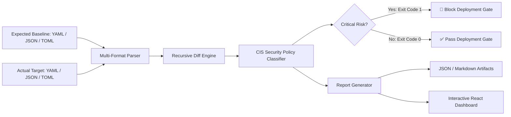
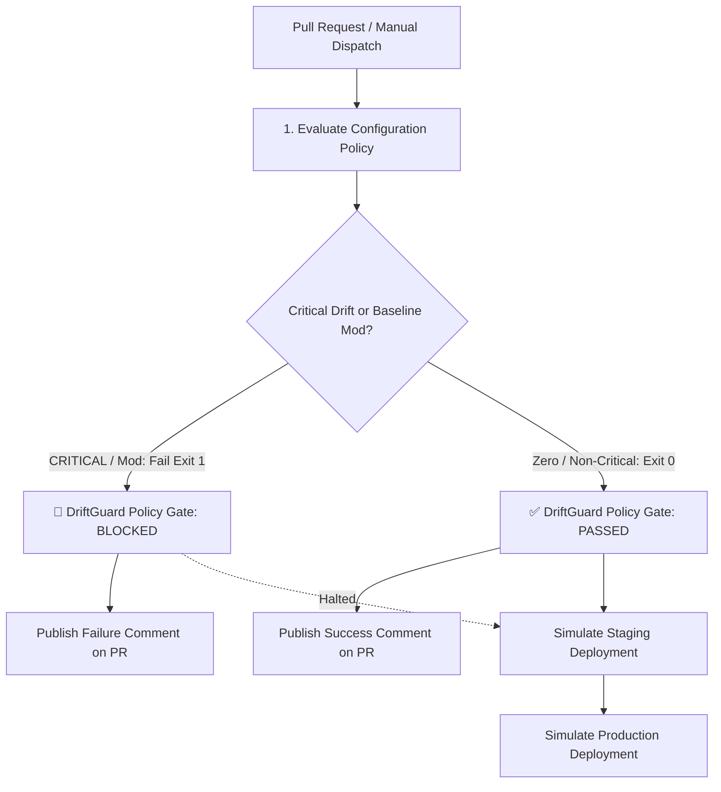

# 🛡️ DriftGuard — Configuration Change Detector & Policy Enforcer

[](https://github.com/jaruguladeepak/driftguard/actions)
[](https://jaruguladeepak.github.io/driftguard/)
[](https://opensource.org/licenses/MIT)

> **DriftGuard** is an automated DevOps & DevSecOps tool that detects configuration drift across **YAML, JSON, and TOML** environments, enforces **CIS Benchmark** security policies, blocks unsafe deployments in CI/CD pipelines, and visualizes differences in an interactive React web dashboard.

---

## 🌐 Live Interactive Dashboard

**Try DriftGuard in your browser:**  
👉 **[https://jaruguladeepak.github.io/driftguard/](https://jaruguladeepak.github.io/driftguard/)**

No local setup required. Switch between preset scenarios (YAML, JSON, TOML), edit configurations live in the dual-pane editor, and export structured JSON or Markdown reports.

---

## 🧩 Architecture



### Technology Stack
- **Frontend:** React 19, TypeScript, Vite, Lucide Icons
- **Core Engine:** Pure TypeScript recursive object comparison & policy evaluation (runs identically in Browser & Node.js)
- **Multi-Format Parsers:** `js-yaml` (YAML), `JSON.parse` (JSON), `smol-toml` (TOML)
- **Testing:** Vitest (20 automated unit tests)
- **CI/CD:** GitHub Actions (automated testing, build, CLI check, report artifact upload, GitHub Pages deployment)

---

## 🛡️ CIS Benchmark & Security Policy Matrix

DriftGuard enforces industry-standard CIS (Center for Internet Security) hardening guidelines:

| Rule ID | Policy Description | Condition | Severity | Gate Action |
|---|---|---|---|---|
| **CIS-APP-1** | Production Debug Mode | `app.debug: true` | **CRITICAL** | 🚨 **BLOCK** (Exit code 1) |
| **CIS-NET-1** | HTTPS Protocol Enforcement | `security.https_required: false` or removed | **CRITICAL** | 🚨 **BLOCK** (Exit code 1) |
| **CIS-TLS-1** | Minimum TLS 1.2+ Protocol | `security.tls_version` < `1.2` (e.g. `1.0`, `1.1`) | **CRITICAL** | 🚨 **BLOCK** (Exit code 1) |
| **CIS-IAM-1** | Prohibit Root Execution | `process.user: "root"` or `docker.privileged: true` | **CRITICAL** | 🚨 **BLOCK** (Exit code 1) |
| **CIS-SEC-1** | Plaintext Secret Exposure | Committed plaintext `api_key`, `secret`, `token` | **CRITICAL** | 🚨 **BLOCK** (Exit code 1) |
| **CIS-NET-2** | Insecure Management Ports | Exposing ports `22` (SSH), `23` (Telnet), `3389` (RDP) | **CRITICAL** | 🚨 **BLOCK** (Exit code 1) |
| **CIS-CORS-1** | Prohibit Wildcard CORS | `security.cors_origin: "*"` in production | **CRITICAL** | 🚨 **BLOCK** (Exit code 1) |
| **DRIFT-NET-PORT** | Service Port Change | Any change to `app.port` | **MEDIUM** | ⚠️ Warning (Exit code 0) |
| **DRIFT-RES-LIMIT** | Resource Limits Removed | Memory or CPU limit removed | **MEDIUM** | ⚠️ Warning (Exit code 0) |
| **DRIFT-GEN-DIFF** | General Configuration Drift | Other added, removed, or changed settings | **LOW** | ℹ️ Notice (Exit code 0) |

---

## 🚦 DevOps Policy Enforcement

DriftGuard acts as an automated configuration policy gate in GitHub Actions.



### Pull Request Checks

When a pull request modifies configuration or policy-related files, the workflow:
1. Runs the automated test suite (`npm test` — 20 tests).
2. Compares the proposed configuration against the trusted baseline.
3. Classifies configuration differences against CIS security rules.
4. Generates a Markdown drift report.
5. Publishes or updates the report as a pull request comment.
6. Fails the required policy check when critical drift is detected.

> **Baseline Protection:** Changes to `config/expected.yaml` are blocked for separate review because the trusted baseline is loaded directly from the pull request's target branch (`origin/main`).

### Manual Policy Testing (Workflow Dispatch)

You can simulate both passing and failing scenarios on-demand:
1. Open the repository's **Actions** tab on GitHub.
2. Select **DriftGuard PR Policy Gate**.
3. Click **Run workflow**.
4. Choose `config/actual.yaml` for the clean baseline demonstration (All gates pass, staging & production simulations run).
5. Choose `config/demo-actual.yaml` to simulate critical drift (DriftGuard Policy Gate fails, blocking staging and production stages).

---

## 💻 Command Line Interface (CLI)

The CLI evaluates **YAML, JSON, or TOML** configurations, outputs terminal summaries with rule explanations, writes reports to `reports/`, and triggers CI blockage via process exit codes:

```powershell
# 1. Clean YAML baseline check (Exit code 0: PASSED)
npm run cli

# 2. Critical drift YAML check (Exit code 1: BLOCKED)
npm run cli -- --actual config/demo-actual.yaml

# 3. Evaluate JSON configurations
npm run cli -- --expected config/sample-expected.json --actual config/sample-actual.json

# 4. Evaluate TOML configurations
npm run cli -- --expected config/sample-expected.toml --actual config/sample-actual.toml
```

---

## 🧪 Automated Testing

DriftGuard includes 20 automated unit tests covering change detection, addition/removal edge cases, YAML/JSON/TOML parsing, CIS security rules, and report formatting:

```powershell
npm test
```

---

## 🛠️ Local Development

```powershell
# 1. Clone repository
git clone https://github.com/jaruguladeepak/driftguard.git
cd driftguard

# 2. Install dependencies
npm install

# 3. Start local development server
npm run dev

# 4. Build for production
npm run build
```

---

## 📂 Repository Structure

```text
driftguard/
├── .github/workflows/
│   ├── driftguard.yml               # Main CI & GitHub Pages deployment
│   └── driftguard-pr-gate.yml       # PR Policy Gate & Release Stage Simulation
├── config/                          # Configuration files
│   ├── expected.yaml                # Production baseline (YAML)
│   ├── actual.yaml                  # Clean target configuration (YAML)
│   ├── demo-actual.yaml             # Deliberately drifted target (YAML)
│   ├── sample-expected.json         # Sample JSON baseline
│   ├── sample-actual.json           # Sample JSON target
│   ├── sample-expected.toml         # Sample TOML baseline
│   └── sample-actual.toml           # Sample TOML target
├── src/
│   ├── core/                        # Core TypeScript engine (shared across CLI & Browser)
│   │   ├── types.ts                 # Type interfaces (DriftFinding, Severity, etc.)
│   │   ├── parser.ts                # Multi-format parser (YAML, JSON, TOML)
│   │   ├── detector.ts              # Recursive diff algorithm
│   │   ├── policies.ts              # CIS Benchmark & risk evaluation rules
│   │   └── reporter.ts              # Terminal, JSON, and Markdown formatters
│   ├── App.tsx                      # Interactive React dashboard
│   ├── index.css                    # Dashboard styling
│   └── cli.ts                       # Node.js CLI script
├── tests/                           # Vitest unit test suite (20 tests)
│   ├── detector.test.ts
│   └── reporter.test.ts
├── legacy-python/                   # Original Python 3.12 prototype
├── package.json
└── vite.config.ts
```
