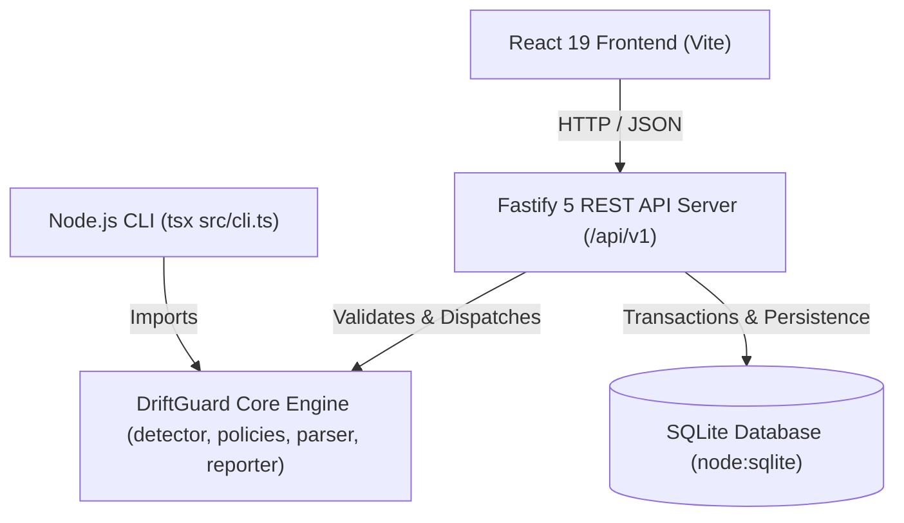
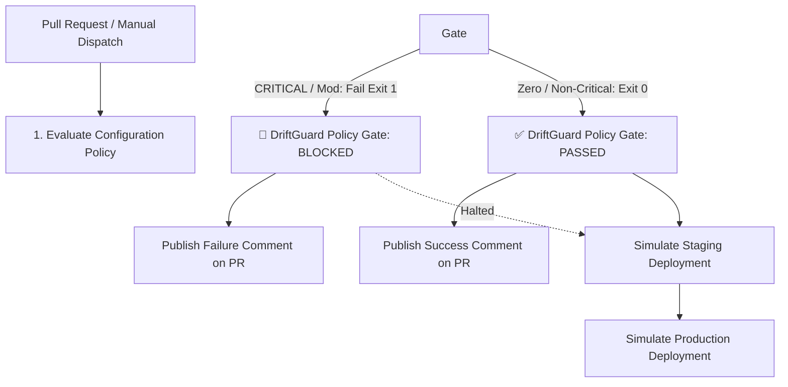

# 🛡️ DriftGuard — Configuration Change Detector & Policy Enforcer

[](https://github.com/jaruguladeepak/driftguard/actions)
[](https://jaruguladeepak.github.io/driftguard/)
[](https://opensource.org/licenses/MIT)

> **DriftGuard** is an automated DevOps & DevSecOps tool that detects configuration drift across **YAML, JSON, and TOML** environments, enforces **CIS Benchmark** security policies, blocks unsafe deployments in CI/CD pipelines, persists audit runs in an SQLite database via a Fastify REST API, and visualizes differences in an interactive React web dashboard.

---

## 🌐 Live Interactive Dashboard

**Try DriftGuard in your browser:**  
👉 **[https://jaruguladeepak.github.io/driftguard/](https://jaruguladeepak.github.io/driftguard/)**

No local setup required. Switch between preset scenarios (YAML, JSON, TOML), edit configurations live in the dual-pane editor, persist runs into the database, and export structured JSON or Markdown reports.

---

## 🧩 Architecture



### Technology Stack
- **Frontend:** React 19, TypeScript, Vite, Lucide Icons
- **Backend REST API:** Fastify 5, `@fastify/cors`, `@fastify/cookie`, `@fastify/rate-limit`
- **Persistence Layer:** SQLite (`node:sqlite` DatabaseSync) with transactional migrations, relational foreign keys & indexes
- **Authentication:** Salted scrypt password hashing, cryptographic sessions, secure cookies & bearer tokens
- **Core Engine:** Pure TypeScript recursive object comparison & policy evaluation (shared across CLI, Browser & Server)
- **Multi-Format Parsers:** `js-yaml` (YAML), `JSON.parse` (JSON), `smol-toml` (TOML)
- **Testing:** Vitest (65 automated unit, database, and integration tests across 5 test suites)
- **CI/CD:** GitHub Actions (automated testing, build, CLI check, report artifact upload, GitHub Pages deployment)

---

## 🛡️ CIS-Inspired Security Policies & Secret Redaction

DriftGuard enforces security hardening policies inspired by CIS (Center for Internet Security) baseline principles for configuration safety:

| Rule ID | Policy Description | Condition | Severity | Gate Action |
|---|---|---|---|---|
| **CIS-APP-1** | Production Debug Mode | `app.debug: true` | **CRITICAL** | 🚨 **BLOCK** (Exit code 1) |
| **CIS-NET-1** | HTTPS Protocol Enforcement | `security.https_required: false` or removed | **CRITICAL** | 🚨 **BLOCK** (Exit code 1) |
| **CIS-TLS-1** | Minimum TLS 1.2+ Protocol | `security.tls_version` < `1.2` (e.g. `1.0`, `1.1`, `TLSv1.0`) | **CRITICAL** | 🚨 **BLOCK** (Exit code 1) |
| **CIS-IAM-1** | Prohibit Root Execution | `process.user: "root"` or `docker.privileged: true` | **CRITICAL** | 🚨 **BLOCK** (Exit code 1) |
| **CIS-SEC-1** | Plaintext Secret Exposure | Committed plaintext `api_key`, `secret`, `token`, `password`, `credential` | **CRITICAL** | 🚨 **BLOCK** (Exit code 1) |
| **CIS-NET-2** | Insecure Management Ports | Exposing ports `22` (SSH), `23` (Telnet), `3389` (RDP) | **CRITICAL** | 🚨 **BLOCK** (Exit code 1) |
| **CIS-CORS-1** | Prohibit Wildcard CORS | `security.cors_origin: "*"` in production | **CRITICAL** | 🚨 **BLOCK** (Exit code 1) |
| **DRIFT-NET-PORT** | Service Port Change | Any change to `app.port` | **MEDIUM** | ⚠️ Warning (Exit code 0) |
| **DRIFT-RES-LIMIT** | Resource Limits Removed | Memory or CPU limit removed | **MEDIUM** | ⚠️ Warning (Exit code 0) |
| **DRIFT-GEN-DIFF** | General Configuration Drift | Other added, removed, or changed settings | **LOW** | ℹ️ Notice (Exit code 0) |

> 🔒 **Automatic Secret Redaction:** Any sensitive credential flagged by `CIS-SEC-1` or key pattern matching is automatically redacted as `[REDACTED_SECRET]` across JSON, Markdown, API responses, and terminal reports, preventing credentials from leaking into CI artifacts or PR comments. *(Note: These heuristics are project-defined baseline hardening rules inspired by CIS benchmarks, not certified compliance audits).*

---

## 🚀 REST API & Persistence Layer

DriftGuard includes a modular Fastify REST API backed by an SQLite database with relational persistence and audit logging:

| Method | Endpoint | Description | Auth Required |
|---|---|---|---|
| `GET` | `/health` | System health and engine status | No |
| `POST` | `/api/v1/auth/register` | Register user with scrypt password hash | No |
| `POST` | `/api/v1/auth/login` | Login and receive secure session cookie | No |
| `POST` | `/api/v1/auth/logout` | Invalidate session | Yes |
| `GET` | `/api/v1/auth/me` | Current authenticated user profile | Yes |
| `GET` | `/api/v1/projects` | List user projects with config & run counts | Yes |
| `POST` | `/api/v1/projects` | Create new project | Yes |
| `GET` | `/api/v1/projects/:id` | Get project details and configurations | Yes |
| `POST` | `/api/v1/projects/:id/configurations` | Save named YAML/JSON/TOML configuration | Yes |
| `POST` | `/api/v1/analyses` | Run drift analysis & persist run + findings | No (Optional) |
| `GET` | `/api/v1/analyses` | List persistent analysis run history | No (Filtered by user if auth) |
| `GET` | `/api/v1/analyses/:id` | Get single analysis run details | No |
| `GET` | `/api/v1/analyses/:id/findings` | Get findings with severity & rule filtering | No |
| `PATCH`| `/api/v1/analyses/findings/:id` | Update review status (`PENDING`/`ACKNOWLEDGED`/`RESOLVED`) | No |
| `GET` | `/api/v1/analyses/:id/reports/json` | Download structured JSON audit report | No |
| `GET` | `/api/v1/analyses/:id/reports/markdown` | Download formatted Markdown report | No |
| `GET` | `/api/v1/analyses/:id/compare/:otherId` | Historical run comparison (new/persistent/resolved) | No |
| `GET` | `/api/v1/audit-events` | Inspect security audit events | Yes |

---

## 🚦 DevOps Policy Enforcement

DriftGuard acts as an automated configuration policy gate in GitHub Actions.



---

## 💻 Command Line Interface (CLI)

The CLI evaluates **YAML, JSON, or TOML** configurations, outputs terminal summaries with rule explanations, writes reports to `reports/`, and triggers CI blockage via process exit codes:

```powershell
# 1. Clean YAML baseline check (Exit code 0: PASSED)
npm run cli

# 2. Critical drift YAML check (Exit code 1: BLOCKED)
npm run cli -- --actual config/demo-actual.yaml

# 3. Evaluate JSON configurations
npm run cli -- --expected config/sample-expected.json --actual config/sample-actual.json

# 4. Evaluate TOML configurations
npm run cli -- --expected config/sample-expected.toml --actual config/sample-actual.toml
```

---

## 🧪 Automated Testing

DriftGuard includes **65 automated unit, database, and API integration tests** across 5 test suites:

```powershell
# Run all 65 tests
npm test

# Run backend server tests only
npm run test:server
```

---

## 🛠️ Local Development

```powershell
# 1. Install dependencies
npm install

# 2. Start Fastify REST API backend (Port 3001)
npm run server

# 3. In another terminal, start React frontend (Port 5173)
npm run dev

# 4. Build both frontend and TypeScript backend for production
npm run build
```

---

## 📂 Repository Structure

```text
driftguard/
├── .github/workflows/
│   ├── driftguard.yml               # Main CI & GitHub Pages deployment
│   └── driftguard-pr-gate.yml       # PR Policy Gate & Release Stage Simulation
├── config/                          # Configuration files (YAML, JSON, TOML)
├── data/                            # SQLite persistent storage (ignored in git)
├── src/
│   ├── api/
│   │   └── client.ts                # Typed frontend API client with offline fallback
│   ├── core/                        # Core TypeScript engine (shared across CLI, Browser & Server)
│   │   ├── types.ts                 # Type interfaces (DriftFinding, Severity, etc.)
│   │   ├── parser.ts                # Multi-format parser (YAML, JSON, TOML)
│   │   ├── detector.ts              # Recursive diff algorithm
│   │   ├── policies.ts              # CIS Benchmark & risk evaluation rules
│   │   └── reporter.ts              # Terminal, JSON, and Markdown formatters
│   ├── server/                      # Fastify REST Backend
│   │   ├── db/
│   │   │   ├── schema.ts            # DDL, tables, and indexes
│   │   │   ├── index.ts             # SQLite DatabaseManager (node:sqlite)
│   │   │   └── repositories.ts      # Data access layer (Users, Projects, Configs, Analyses, Audit)
│   │   ├── services/
│   │   │   ├── auth.ts              # Scrypt password hashing & session management
│   │   │   └── analysis.ts          # Core engine coordination & historical comparison
│   │   ├── app.ts                   # Fastify app, plugins, middleware, security headers & routes
│   │   └── index.ts                 # Server entrypoint with graceful shutdown
│   ├── App.tsx                      # Interactive React dashboard with History & DB sync
│   ├── index.css                    # Dashboard styling
│   └── cli.ts                       # Node.js CLI script
├── tests/                           # Vitest test suite (65 tests)
│   ├── detector.test.ts             # Core diff engine tests (16 tests)
│   ├── reporter.test.ts             # Report formatting tests (4 tests)
│   ├── edge_cases.test.ts           # Secret redaction, TLS & port edge cases (13 tests)
│   ├── db.test.ts                   # SQLite schema, transactions, and comparison tests (6 tests)
│   └── api.test.ts                  # Fastify REST API endpoints & security tests (26 tests)
├── package.json
├── tsconfig.json
└── vite.config.ts
```
