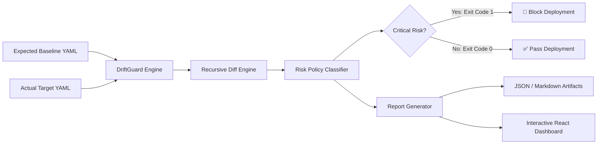
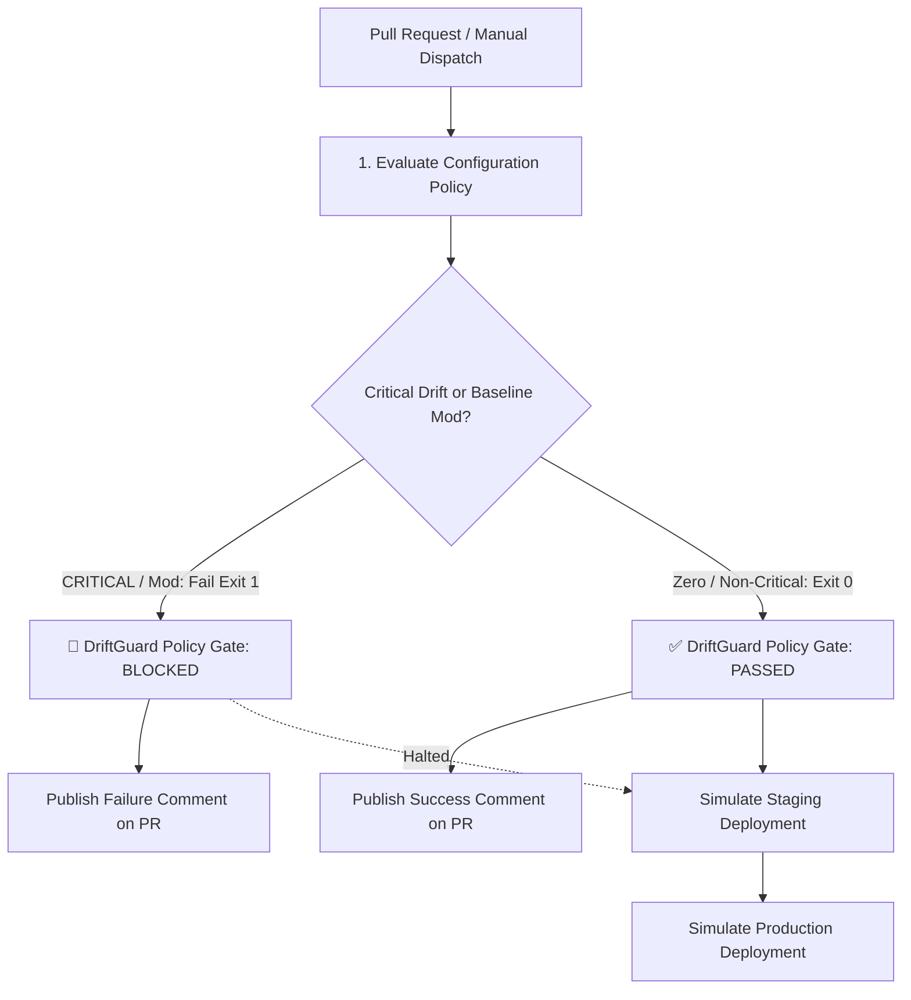

# 🛡️ DriftGuard — Configuration Change Detector & Policy Enforcer

[](https://github.com/jaruguladeepak/driftguard/actions)
[](https://jaruguladeepak.github.io/driftguard/)
[](https://opensource.org/licenses/MIT)

> **DriftGuard** is an automated DevOps & DevSecOps tool that detects configuration drift between baseline environments and target states, classifies risk severity (`CRITICAL`, `MEDIUM`, `LOW`), blocks unsafe production deployments, and visualizes differences in an interactive React web dashboard.

---

## 🌐 Live Interactive Dashboard

**Try DriftGuard in your browser:**  
👉 **[https://jaruguladeepak.github.io/driftguard/](https://jaruguladeepak.github.io/driftguard/)**

No local setup required. Switch between preset scenarios, edit YAML live in the dual-pane editor, and export structured JSON or Markdown reports.

---

## 🧩 Architecture



### Technology Stack
- **Frontend:** React 19, TypeScript, Vite, Lucide Icons
- **Core Engine:** Pure TypeScript recursive object comparison & policy evaluation (runs identically in Browser & Node.js)
- **Parser:** `js-yaml`
- **Testing:** Vitest (12 unit tests)
- **CI/CD:** GitHub Actions (automated testing, build, CLI check, report artifact upload, GitHub Pages deployment)

---

## 🚦 DevOps Policy Enforcement

DriftGuard acts as an automated configuration policy gate in GitHub Actions.



### Pull Request Checks

When a pull request modifies configuration or policy-related files, the workflow:
1. Runs the automated test suite (`npm test`).
2. Compares the proposed configuration against the trusted baseline.
3. Classifies configuration differences by severity (`CRITICAL`, `MEDIUM`, `LOW`).
4. Generates a Markdown drift report.
5. Attempts to publish or update the report as a pull request comment.
6. Fails the required policy check when critical drift is detected.

> **Baseline Protection:** Changes to `config/expected.yaml` are blocked for separate review because the trusted baseline is loaded directly from the pull request's target branch (`origin/main`).

### Policy Severity Rules

| Severity | Example | Policy Behavior |
|---|---|---|
| **CRITICAL** | `app.debug: true` | 🚨 **BLOCK** (Status check fails, prevents merge) |
| **CRITICAL** | `security.https_required: false` | 🚨 **BLOCK** (Status check fails, prevents merge) |
| **MEDIUM** | `app.port` changes | ⚠️ **ALLOW** by default (Review notice) |
| **LOW** | Other additions / modifications | ℹ️ **ALLOW** by default |

### Manual Policy Testing (Workflow Dispatch)

You can simulate both passing and failing scenarios on-demand:
1. Open the repository's **Actions** tab on GitHub.
2. Select **DriftGuard PR Policy Gate**.
3. Click **Run workflow**.
4. Choose `config/actual.yaml` for the clean baseline demonstration (All gates pass, staging & production simulations run).
5. Choose `config/demo-actual.yaml` to simulate critical drift (DriftGuard Policy Gate fails, blocking staging and production stages).

### Enforcing Pull Request Merges

A failed workflow alone does not prevent merging unless repository rules require that check. To enforce blocking:
1. Go to repository **Settings** → **Branches** (or **Rulesets**).
2. Add a rule for `main`.
3. Check **Require status checks to pass before merging**.
4. Select **DriftGuard Policy Gate**.

---

## 💻 Command Line Interface (CLI)

The CLI evaluates YAML configurations, outputs terminal summaries, writes reports to `reports/`, and triggers CI blockage via process exit codes:

```powershell
# 1. Clean baseline check (Exit code 0: PASSED)
npm run cli

# 2. Drifted demo check (Exit code 1: BLOCKED)
npm run cli -- --actual config/demo-actual.yaml

# 3. Custom files
npm run cli -- --expected path/to/expected.yaml --actual path/to/actual.yaml
```

---

## 🧪 Automated Testing

DriftGuard includes 12 automated unit tests covering change detection, addition/removal edge cases, policy evaluation, invalid YAML structures, and report formatting:

```powershell
npm test
```

---

## 🛠️ Local Development

```powershell
# 1. Clone repository
git clone https://github.com/jaruguladeepak/driftguard.git
cd driftguard

# 2. Install dependencies
npm install

# 3. Start local development server
npm run dev

# 4. Build for production
npm run build
```

---

## 📂 Repository Structure

```text
driftguard/
├── .github/workflows/
│   ├── driftguard.yml               # Main CI & GitHub Pages deployment
│   └── driftguard-pr-gate.yml       # PR Policy Gate & Release Stage Simulation
├── config/                          # Configuration files
│   ├── expected.yaml                # Production baseline
│   ├── actual.yaml                  # Clean target configuration
│   └── demo-actual.yaml             # Deliberately drifted target
├── src/
│   ├── core/                        # Core TypeScript engine (shared across CLI & Browser)
│   │   ├── types.ts                 # Type interfaces
│   │   ├── detector.ts              # Recursive diff algorithm
│   │   ├── policies.ts              # Risk evaluation & blocker rules
│   │   └── reporter.ts              # Terminal, JSON, and Markdown formatters
│   ├── App.tsx                      # Interactive React dashboard
│   ├── index.css                    # Dashboard styling
│   └── cli.ts                       # Node.js CLI script
├── tests/                           # Vitest unit test suite
│   ├── detector.test.ts
│   └── reporter.test.ts
├── legacy-python/                   # Original Python 3.12 prototype
├── package.json
└── vite.config.ts
```
