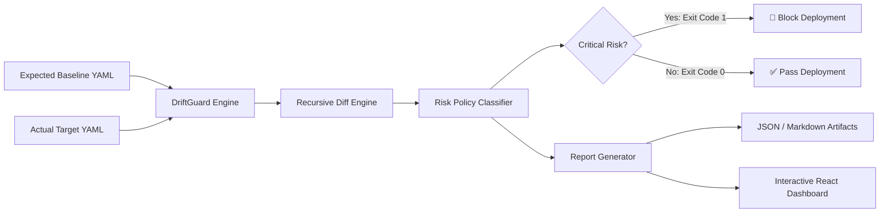

# 🛡️ DriftGuard — Configuration Change Detector & Policy Enforcer

[](https://github.com/jaruguladeepak/driftguard/actions)
[](https://jaruguladeepak.github.io/driftguard/)
[](https://opensource.org/licenses/MIT)

> **DriftGuard** is an automated DevOps & DevSecOps tool that detects configuration drift between baseline environments and target states, classifies risk severity (`CRITICAL`, `MEDIUM`, `LOW`), blocks unsafe production deployments, and visualizes differences in an interactive React web dashboard.

---

## 🌐 Live Interactive Dashboard

**Try DriftGuard in your browser:**  
👉 **[https://jaruguladeepak.github.io/driftguard/](https://jaruguladeepak.github.io/driftguard/)**

No local setup required. Switch between preset scenarios, edit YAML live in the dual-pane editor, and export structured JSON or Markdown reports.

---

## 🧩 Architecture



### Technology Stack
- **Frontend:** React 19, TypeScript, Vite, Lucide Icons
- **Core Engine:** Pure TypeScript recursive object comparison & policy evaluation (runs identically in Browser & Node.js)
- **Parser:** `js-yaml`
- **Testing:** Vitest (12 unit tests)
- **CI/CD:** GitHub Actions (automated testing, build, CLI check, report artifact upload, GitHub Pages deployment)

---

## ⚖️ Policy Classification Matrix

| Setting | Condition | Severity | Deployment Action |
|---|---|---|---|
| `app.debug` | Value equals `true` | **CRITICAL** | 🚨 **BLOCK** (Exit code 1) |
| `security.https_required` | Removed or `false` | **CRITICAL** | 🚨 **BLOCK** (Exit code 1) |
| `app.port` | Any port change | **MEDIUM** | ⚠️ Warning (Exit code 0) |
| Other settings | Added / Removed / Changed | **LOW** | ℹ️ Notice (Exit code 0) |

---

## 💻 Command Line Interface (CLI)

The CLI evaluates YAML configurations, outputs terminal summaries, writes reports to `reports/`, and triggers CI blockage via process exit codes:

```powershell
# 1. Clean baseline check (Exit code 0: PASSED)
npm run cli

# 2. Drifted demo check (Exit code 1: BLOCKED)
npm run cli -- --actual config/demo-actual.yaml

# 3. Custom files
npm run cli -- --expected path/to/expected.yaml --actual path/to/actual.yaml
```

---

## 🧪 Automated Testing

DriftGuard includes 12 automated unit tests covering change detection, addition/removal edge cases, policy evaluation, invalid YAML structures, and report formatting:

```powershell
npm test
```

---

## 🛠️ Local Development

```powershell
# 1. Clone repository
git clone https://github.com/jaruguladeepak/driftguard.git
cd driftguard

# 2. Install dependencies
npm install

# 3. Start local development server
npm run dev

# 4. Build for production
npm run build
```

---

## 📂 Repository Structure

```text
driftguard/
├── .github/workflows/       # GitHub Actions CI/CD pipeline
│   └── driftguard.yml
├── config/                  # Configuration files
│   ├── expected.yaml        # Production baseline
│   ├── actual.yaml          # Clean target configuration
│   └── demo-actual.yaml     # Deliberately drifted target
├── src/
│   ├── core/                # Core TypeScript engine (shared across CLI & Browser)
│   │   ├── types.ts         # Type interfaces
│   │   ├── detector.ts      # Recursive diff algorithm
│   │   ├── policies.ts      # Risk evaluation & blocker rules
│   │   └── reporter.ts      # Terminal, JSON, and Markdown formatters
│   ├── App.tsx              # Interactive React dashboard
│   ├── index.css            # Dashboard styling
│   └── cli.ts               # Node.js CLI script
├── tests/                   # Vitest unit test suite
│   ├── detector.test.ts
│   └── reporter.test.ts
├── legacy-python/           # Original Python 3.12 prototype
├── package.json
└── vite.config.ts
```
